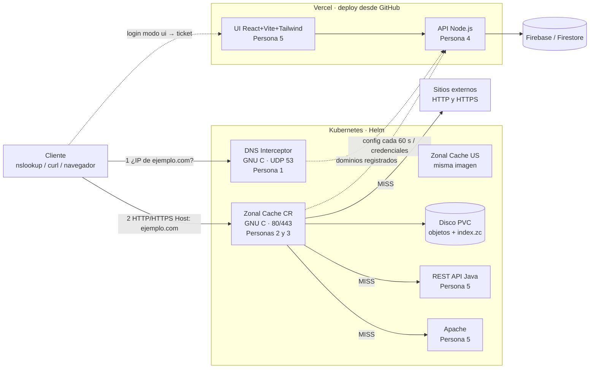

# Proyecto 2 (IC7602) — Estado del sistema y plan de integración

Estado revisado: **31 de octubre de 2026** · Entrega indicada: **martes 3 de noviembre** (antes de medianoche) ·
Evaluación presencial indicada: martes 10 de noviembre.

Este documento resume **qué hay hoy en el repositorio**, **qué hace cada parte**, **qué contratos tienen que
respetar entre sí** y **en qué orden pegar todo**. El diagrama editable está en
[`docs/arquitectura.drawio`](arquitectura.drawio) (página 1: arquitectura; página 2: flujo dentro de la caché).
El plan y las fechas de integración de §6 son la propuesta original; deben leerse como referencia, no como
confirmación de que esos despliegues o pruebas ya se realizaron.

---

## 1. Arquitectura

El diagrama y el flujo siguientes describen la arquitectura objetivo; no implican que todos los componentes
estén integrados o desplegados actualmente. El estado implementado se detalla en §2 y §8.



**Recorrido de una petición:**

1. El cliente pregunta al **DNS Interceptor** por `ejemplo.com`. Si el dominio está registrado, el interceptor
   averigua el país del cliente (IP-to-Country), elige la caché zonal de su zona y responde **la IP de esa
   caché**. Si no está registrado, reenvía la consulta al resolver real.
2. El cliente se conecta a esa IP (puerto 80 o 443) con `Host: ejemplo.com`.
3. La **Zonal Cache** termina TLS si es HTTPS, busca el dominio y la URL en su configuración (que viene de
   Firebase por medio del API Node.js), valida la seguridad (API key o usuario/contraseña con sesión), y
   sirve desde disco (HIT) o pide al origen, guarda y sirve (MISS), expulsando con LRU/LFU/FIFO/MRU/Random.
4. El **UI** es donde la persona dueña del dominio configura todo eso; el **API Node.js** lo guarda en
   Firestore y se lo entrega a las cachés.

---

## 2. Qué hay hoy en el repositorio

| Carpeta | Dueña/o | Estado actual |
|---|---|---|
| `Interceptor/dns.c` | Persona 1 | **Es la versión del Proyecto 1, sin adaptar.** Atiende consultas A, consulta `DNS_API_URL/api/records/<nombre>?sourceIp=` y elige IP con estrategias single/multi/weight/geo/round-trip; si no, reenvía a `/api/dns_resolver`. **No** hay selección de caché zonal, ni Dockerfile, ni Helm. |
| `ZonalCache/p3/` | Persona 3 | Biblioteca de políticas, configuración, autenticación, TLS, registro y gate; tiene pruebas unitarias. La revisión del 31 de octubre confirmó 166 comprobaciones de políticas; la suite C completa no se pudo correr en ese entorno por falta de headers de libcurl. |
| `ZonalCache/tools/zc_p3_demo.c` | Persona 3 | Servidor de **prueba** que ya usa toda la biblioteca, con origen simulado. Plantilla para la Persona 2. |
| `ZonalCache/Dockerfile`, `ZonalCache/helm/zonal-cache/` | Persona 3 (P2 cambia el binario) | Escritos. **No validados** todavía con `docker build` / `helm lint` (ver §7). |
| Servidor HTTP / proxy / caché en disco | Persona 2 | El servidor demo existe, pero simula el origen; **falta el proxy real** a los orígenes de la configuración. |
| API Node.js | Persona 4 | Existe `api-nodejs/src/cache-routes.js` con `GET /api/cache/config` y `POST /api/cache/verify-credentials`, montadas desde `src/app.js`. Sus cuatro pruebas pasan; el e2e del demo usa un almacén en memoria. Firestore real, despliegue de producción y selección por zona no están validados. El resto de rutas de administración que requeriría la UI también está pendiente. |
| `frontend/` | Persona 5 | Proyecto React 19 + Vite 8 + Tailwind 4 + `vercel.json`. Solo una página de bienvenida: registro, dominios, URLs, usuarios, keys y login están **pendientes**. |
| REST API Java, Apache | Persona 5 | **No existen aún en el repo.** |
| `kubectl.exe` (raíz) | — | Binario de Windows de 63 MB versionado. **Recomiendo sacarlo del repo** (y del historial si se puede) y agregarlo al `.gitignore`. |
| `README.md` (raíz) | Todos | Solo instrucciones del frontend. La documentación final (en Markdown) está pendiente. |

---

## 3. Lo que ya hace la parte de la Persona 3

Detalle técnico completo en [`ZonalCache/docs/PERSONA3.md`](../ZonalCache/docs/PERSONA3.md).

| Requisito del enunciado | Cómo está resuelto | Pruebas |
|---|---|---|
| LRU, LFU, FIFO, MRU, Random | `zc_policy.c`: índice de metadatos (secuencia de inserción, de acceso, hits, expiración). | unitarias + e2e |
| Tamaño máximo por dominio desde Firebase | `maxCacheBytes` del dominio; si Firebase lo baja, se expulsa al refrescar. | unitarias |
| Tamaño de caché por URL (lo pide el UI) | `cacheBytes` de cada URL: primero compiten solo los objetos de esa URL. | unitarias + e2e |
| Tipos de archivo, TTL y política por URL | `fileTypes[{ext, ttl, policy}]`, con `ext:"*"` como comodín. | unitarias + e2e |
| Autenticación con `x-api-key` | SHA-256 de la key contra los hashes de Firestore, comparación en tiempo constante → 401. | unitarias + e2e |
| Usuario/contraseña "realizando un llamado al UI" | La biblioteca/demo soporta `local` (formulario en la caché y verificación con el API) y el flujo `ui` con ticket firmado; este último se prueba contra el mock, no contra una UI/API real. | unitarias + e2e con mock |
| Verificar la sesión en peticiones posteriores | Cookie `zc_session` HttpOnly/SameSite/Secure, ligada a dominio + URL, con expiración y logout (`/__zc/logout`). | unitarias + e2e |
| SSL termination | OpenSSL, TLS ≥ 1.2, y **SNI** (un certificado por dominio). | handshake real |
| Configuración desde Firebase | Descarga del API cada 60 s; si falla o viene inválida se conserva la última buena; snapshots seguros entre hilos. | unitarias + e2e |
| Nada quemado en código | Todo por variables de entorno (tabla en `PERSONA3.md`). | — |
| Extra de seguridad | CSRF en el formulario, rate limit de login (429), anti open-redirect, cookies de la caché no se reenvían al origen. | unitarias + e2e |

La documentación del módulo registra **7 suites unitarias (341 verificaciones)** y **29 pruebas e2e** para
`make test` y `make e2e`. En la revisión del 31 de octubre se ejecutaron 166 comprobaciones de la suite de
políticas y las 4 pruebas de `api-nodejs` (todas pasaron); no se completaron `make test` ni las e2e porque el
entorno WSL no tenía los headers de libcurl y no permitió instalarlos. La prueba `make e2e-api` utiliza un
almacén en memoria, no Firestore real.

---

## 4. Contratos entre componentes (lo que hay que acordar YA)

### 4.1 Zonal Cache ⇄ API Node.js (Personas 2/3 ⇄ 4)

El adaptador de caché ya está implementado en `api-nodejs/src/cache-routes.js` y montado bajo `/api/cache` en
`api-nodejs/src/app.js`. Las pruebas de `api-nodejs` comprueban el adaptador; `api-nodejs/test/serve-memory.js`
permite probarlo desde `make e2e-api` sin Firebase. Esto valida el contrato con datos simulados, no la
configuración de Firestore en producción.

| Endpoint | Quién lo llama | Respuesta |
|---|---|---|
| `GET /api/cache/config?zone=cr` + `Authorization: Bearer <ZC_CONFIG_TOKEN>` | cada caché, cada 60 s | `200` + JSON de config (formato abajo) |
| `POST /api/cache/verify-credentials` + Bearer, cuerpo `{"domain","pattern","username","password"}` | caché (modo `local`) | `200` válidas · `401` inválidas |
| Emisión de ticket (interno del API, lo pide el UI después del login) | UI (modo `ui`) | ticket `base64url(JSON).hexHMAC` |

Aunque la caché envía `?zone=<zona>`, el endpoint actual no filtra por ese parámetro: devuelve la configuración
de todos los dominios verificados. La selección/aislamiento de configuración por zona está pendiente.

Formato de la config (ejemplo completo en `ZonalCache/docs/ejemplo-config.json`):

```json
{ "domains": [ { "domain": "ejemplo.com", "origin": "https://ejemplo.com", "maxCacheBytes": 104857600,
  "urls": [ { "pattern": "/privado/*", "cacheBytes": 5242880, "auth": { "mode": "userpass" },
              "fileTypes": [ { "ext": "png", "ttl": 3600, "policy": "LFU" }, { "ext": "*", "ttl": 60, "policy": "LRU" } ] },
            { "pattern": "/api/*", "auth": { "mode": "apikey", "apiKeyHashes": ["<sha256 hex>"] } } ] } ] }
```

Puntos pendientes/contratos que debe cuidar el equipo:
- Solo devolver **dominios verificados por TXT**.
- `apiKeyHashes` = SHA-256 hex; **nunca** guardar la key en claro (el UI la muestra una sola vez al crearla).
- Contraseñas con bcrypt/argon2.
- El UI define tamaño por URL; si no hay un tamaño por dominio en el UI, el API puede mandar
  `maxCacheBytes` = suma de los `cacheBytes` de sus URLs.
- El router de caché implementa la conversión y verificación de credenciales; `api-nodejs/test/memory-store.js`
  y `test/serve-memory.js` proporcionan datos y almacén de prueba. `ZonalCache/tests/mock-api.mjs` es otro mock,
  usado por `make e2e`, y contiene el flujo de ticket que el API/UI real aún no implementa.
- La caché envía `zone`, pero `buildCacheConfig` convierte actualmente todos los dominios verificados sin
  filtrar por zona. Para despliegues CR/US hace falta acordar e implementar ese criterio.

### 4.2 UI ⇄ Zonal Cache (Persona 5 ⇄ 3), solo si usamos modo `ui`

- La caché redirige a `{ZC_LOGIN_UI_URL}?domain=ejemplo.com&pattern=/privado/*&callback=https://ejemplo.com/__zc/callback&return_to=/privado/x`.
- La página del UI pide usuario/contraseña, el API valida y genera el ticket, y el UI redirige a
  `callback?ticket=<ticket>&return_to=<return_to>`.
- **Obligatorio:** el UI/API debe rechazar el `callback` si su host no es igual a `domain` (si no, se le
  entrega el ticket a otro sitio). El mock ya lo hace (prueba e2e "UI rechaza callback de otro dominio").
- "Cerrar sesión" en la caché es `GET /__zc/logout` en el dominio protegido; el UI puede enlazarlo.

> **Decisión del equipo:** el enunciado dice que el UI tiene un "formulario de autenticación que será
> utilizado por las cachés zonales", así que el modo `ui` es el que más calza. El modo `local` queda como
> respaldo si el UI no llega a tiempo (solo cambia `ZC_LOGIN_MODE`).

### 4.3 Servidor HTTP ⇄ módulos P3 (Persona 2 ⇄ 3)

La Persona 2 llama `zc_gate_handle()` una vez por petición y recibe o una respuesta lista (401/302/404/login)
o `ZC_GATE_PROXY` con origen, clave de caché, TTL, política, índice del dominio y carpeta en disco.
`tools/zc_p3_demo.c` es un servidor completo que ya lo hace; lo que falta está marcado `>>> PERSONA 2 <<<`:

- Proxy real a `domain->origin` con libcurl (HTTP **y HTTPS**), reenviando método, cuerpo y encabezados,
  **sin** `x-api-key` y con `Cookie: g.upstream_cookie`. El `Host` hacia el origen es el del origen.
- Guardar el objeto en `<domain_dir>/<cache_key>` (escritura a tmp + rename) **junto con su Content-Type**
  (si se guarda en otro archivo, borrarlo también en el callback de expulsión).
- Solo cachear respuestas `200` de GET (`g.cacheable`). Si `g.authenticated`, responder con `Cache-Control: private`.
- HTTP/1.1 con `Content-Length` o `chunked`; keep-alive es opcional.
- Llamar `zc_gate_shutdown()` en SIGTERM (guarda índices).

### 4.4 DNS Interceptor ⇄ resto (Persona 1)

Lo que falta adaptar en `dns.c`:
1. **Lista de dominios registrados**: pedirla al API (puede reutilizar `GET /api/cache/config` con el mismo
   Bearer, o un `GET /api/cache/domains` más liviano) y refrescarla periódicamente.
2. **País del cliente** con la base IP-to-Country (local en la imagen o consultada al API, como en el P1).
3. **País → zona → IP de la caché**, por variables de entorno, p.ej.
   `ZONE_MAP="CR=cr,PA=cr,NI=cr,*=us"`, `ZC_ADDR_CR=10.x.x.x`, `ZC_ADDR_US=10.y.y.y`.
4. Responder A con esa IP; los dominios no registrados se siguen reenviando al resolver (eso ya existe).
5. Quitar el default `http://localhost:8080` de `DNS_API_URL` (el enunciado prohíbe valores quemados).
6. Dockerfile + Helm (Service UDP 53).

> **Ojo:** un registro A no lleva puerto. El cliente se conectará al **80/443** de la IP que devuelva el
> interceptor, así que cada zona necesita **su propia IP con 80/443** (Service `LoadBalancer` con
> `minikube tunnel` o MetalLB). El chart de la caché ya usa `LoadBalancer` por esa razón.
> Además, las cachés **no** deben usar el interceptor como DNS (se formaría un bucle): usan el CoreDNS del clúster.

### 4.5 Nombres comunes (propuesta para no chocar)

| Cosa | Nombre / valor |
|---|---|
| Releases de Helm | `dns-interceptor`, `zc-cr`, `zc-us`, `rest-api-java`, `apache-web` |
| Origen REST Java en la config | `http://rest-api-java.default.svc.cluster.local:8080` |
| Origen Apache en la config | `http://apache-web.default.svc.cluster.local` |
| Secret de la caché | `zc-secrets` con `ZC_CONFIG_TOKEN` y `ZC_TICKET_SECRET` |
| Secret TLS | `zc-tls` (`kubectl create secret tls zc-tls --cert=... --key=...`) |
| Variables en Vercel (API) | `CACHE_API_TOKEN` (= `ZC_CONFIG_TOKEN`), `TICKET_SECRET` (= `ZC_TICKET_SECRET`), credenciales de Firebase |
| Ruta de login del UI | `/cache-login` |
| Rutas reservadas de la caché | `/__zc/login`, `/__zc/callback`, `/__zc/logout` |

---

## 5. Qué necesito de cada compañera/o para empezar a pegar

| Persona | Entregable mínimo para integrar | Cómo se prueba sin los demás |
|---|---|---|
| 1 | `dns.c` adaptado (§4.4) + Dockerfile + chart; `nslookup -port=<p> ejemplo.com <ip>` devuelve la IP de la zona correcta | Con el mock (`node ZonalCache/tests/mock-api.mjs`) como API |
| 2 | Servidor HTTP con `zc_gate` (partiendo de `tools/zc_p3_demo.c`) + proxy real + disco | `make e2e` debe seguir en verde cambiando el demo por su binario |
| 4 | Completar el uso del modelo Firestore, configurar secretos/despliegue de producción y coordinar el filtrado por zona | Probar con Firestore real; el adaptador ya tiene pruebas y el e2e local usa almacén simulado |
| 5 | UI (registro, dominios TXT, URLs con wildcards, tipos/TTL/política, usuarios, keys, `/cache-login`, logout) + REST Java + Apache con charts | Apache/Java: `curl` directo; UI: contra el API de la Persona 4 |
| 3 (yo) | Biblioteca y demo implementados; apoyar la integración con el servidor real, ajustar contratos y validar e2e en el clúster | `make test && make e2e` |

---

## 6. Plan de integración

| Cuándo | Qué |
|---|---|
| **Lun 26** | Revisar este documento juntos y congelar contratos (§4) y nombres (§4.5). Crear los Secrets. Sacar `kubectl.exe`. |
| **Lun 26 – Mié 28** | Cada quien termina su pieza contra el mock. P2 integra `zc_gate`. P4 publica los endpoints. P1 adapta el interceptor. |
| **Jue 29** | Reporte de avance P2R. Primer despliegue en el clúster: Apache + Java + `zc-cr` con `ZC_CONFIG_FILE`. |
| **Vie 30 – Sáb 31** | Cambiar a `ZC_CONFIG_URL` (API real). Agregar `zc-us` y el interceptor. Probar con `nslookup` + `curl`. |
| **Dom 1 – Lun 2** | Pruebas con los 4 orígenes exigidos (REST API, Apache, sitio externo HTTP, sitio externo HTTPS). Documentación final. |
| **Mar 3** | Entrega: tar.gz + link al repo. |

**Script único de despliegue (recomendado):** un `deploy/install.sh` en la raíz que cree los Secrets desde un
`.env` y haga `helm upgrade --install` de todos los charts. El enunciado califica con 0 lo que no esté automatizado.

**Prueba de humo del sistema completo:**

```bash
nslookup -port=53 ejemplo.com <ip-del-interceptor>            # → IP de zc-cr (cliente de CR)
curl -i http://ejemplo.com/index.html                         # X-Cache: MISS y luego HIT
curl -i -H "x-api-key: <key>" http://ejemplo.com/api/items    # 200 (sin key: 401)
curl -i http://ejemplo.com/privado/a.png                      # 302 al login
curl -ik https://ejemplo.com/index.html                       # SSL termination
```

---

## 7. Riesgos y pendientes

1. **Persona 2 es el camino crítico**: sin servidor real no hay Zonal Cache. Mitigación: el demo ya cubre
   todo menos el proxy y el disco, así que se puede partir de él.
2. **Validación TXT**: hace falta un dominio que el equipo controle (o un subdominio gratuito) para crear el
   registro TXT; los dominios de prueba tipo `ejemplo.com` no se pueden verificar.
3. **Sitio externo HTTPS**: el navegador mostrará advertencia porque el certificado de la caché no es del
   sitio real. Para la demostración usar `curl -k` o importar el certificado de desarrollo.
4. **IP por zona**: ver la nota de §4.4 (LoadBalancer / `minikube tunnel`).
5. **Docker y Helm de la caché no están validados**: ejecutar `docker build -t zonal-cache:dev ZonalCache` y
   `helm lint ZonalCache/helm/zonal-cache --set config.url=http://x`.
6. **Sesiones en memoria**: una réplica por zona (ya configurado en el chart).

---

## 8. Estado resumido: qué funciona y qué falta

| Componente | Funciona | No funciona / pendiente |
|---|---|---|
| DNS Interceptor | Código del P1 atiende consultas A y reenvía las demás | Selección de caché zonal por país, Dockerfile y Helm |
| Zonal Cache | Biblioteca P3 con políticas, TTL, límites, autenticación, sesiones, TLS/SNI y refresco de config; el demo permite probarla contra un origen simulado | Proxy al origen real integrado en el servidor P2; separar config por zona; validar Docker/Helm |
| API Node.js | Router `/api/cache/*` para entregar configuración y verificar credenciales; 4 pruebas del adaptador pasan | Firestore real/despliegue de producción no validados; filtrado por `zone`; restantes rutas de administración que necesita la UI |
| UI | Aplicación base configurada para Vercel | Pantallas de administración y `/cache-login`; el flujo UI/ticket solo está en el mock |
| REST API / Apache | — | Ambos componentes y sus charts |
